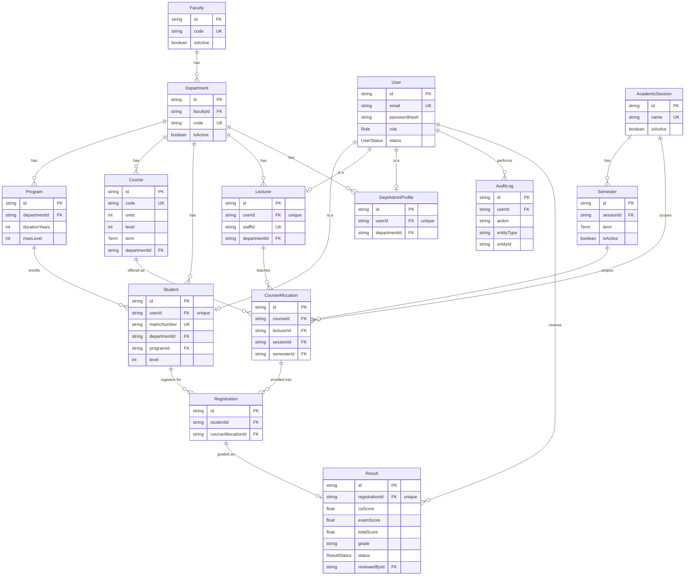

# UEMP — Database Design

PostgreSQL via Prisma. Full schema: `backend/prisma/schema.prisma`. This document is a
readable summary of the same structure.

## Entity-Relationship Diagram

`GradingScale` (score range → letter grade + grade point) is a standalone reference
table with no foreign keys — it's read by the grading utility, not joined.

## Design notes

- **Identity vs. role profile**: `User` holds auth/account fields only (email,
  password hash, role, status). Each role's extra fields live in a separate 1:1
  table (`Student`, `Lecturer`, `DeptAdminProfile`) rather than one wide `users`
  table with mostly-null columns — a user has at most one of these, enforced by a
  `@unique` on the foreign key, and `onDelete: Cascade` keeps the profile from
  outliving its `User` row.
- **Institutional hierarchy**: `Faculty → Department → Program/Course` mirrors how a
  real university is organized, and every operational table (`Student`, `Lecturer`,
  `Course`) hangs off `Department`, which is what makes departmental data isolation
  possible — a Department Admin's queries are scoped by their own `departmentId`,
  never a client-supplied one.
- **Why `CourseAllocation` exists** instead of a direct `Course ↔ Lecturer` link:
  the same course is taught by (possibly different) lecturers across different
  sessions/semesters, so "who teaches what, when" is its own entity. `Registration`
  then points at a specific `CourseAllocation`, not just a `Course` — a student's
  registration is tied to a specific session/semester/lecturer offering.
- **`Result` is optional on `Registration`** (`Registration.result?`): registering
  for a course and having a result are different states — the result is only
  created once a lecturer starts entering scores, which is what lets the UI show
  "Registered, not yet graded" accurately.
- **Result state machine**: `DRAFT → SUBMITTED → APPROVED`, with `REJECTED` looping
  a submission back to the lecturer (with `rejectionReason`) for correction and
  resubmission. `reviewedById`/`reviewedAt` record which Department Admin acted on
  it, for the audit trail.
- **Soft state, not hard deletes**: `Faculty`, `Department`, `Program`, and `Course`
  all have `isActive` rather than being deletable — deactivating one hides it from
  active workflows without destroying the historical records (results, past
  registrations) that point at it.
- **Indexes** are placed on every foreign key used in a scoped lookup
  (`departmentId`, `lecturerId`, `sessionId`+`semesterId`) and on `Result.status`
  and `AuditLog.entityType`+`entityId`/`createdAt`, since those are the columns
  actually filtered on in the approval queues, class lists, and audit log views.
